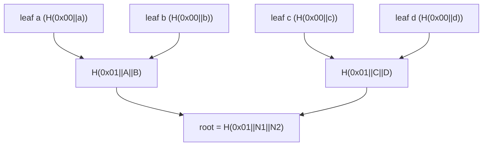

<div align="center">

# merkle-tree

Fast, tiny, no_std-friendly SHA-256 Merkle tree with inclusion proofs and a clean API.

[](https://github.com/SibghatUllah1997/zk-merkle-rs/actions/workflows/ci.yml)


</div>

### Why it matters
- Merkle trees are a foundational building block for integrity, inclusion proofs, and commitments in distributed systems and blockchains.
- This crate focuses on correctness and clarity with explicit domain separation and a small surface area suitable for audits and teaching.

### Features
- Proofs: generate and verify inclusion proofs
- Indexed proofs: carry original leaf index alongside the proof
- serde support: optional `serde` derive on proof/root types
- no_std: works without `std` (uses `alloc`) via feature flags
- Clear domain separation:
  - Leaf hash: H(0x00 || data)
  - Internal node hash: H(0x01 || left || right)
  - Odd layers are padded by duplicating the last element (single-leaf root = leaf hash)

### Install
Add to your `Cargo.toml` (git until published):

```toml
[dependencies]
merkle-tree = { git = "https://github.com/SibghatUllah1997/zk-merkle-rs", features = ["serde"] }
```

no_std users can disable `std`:
```toml
merkle-tree = { git = "https://github.com/SibghatUllah1997/zk-merkle-rs", default-features = false, features = ["serde"] }
```

### CLI demo
Build the `merkle` binary (needs the default `std` feature) to print roots and check proofs:

```bash
cargo run --bin merkle -- build a b c d
cargo run --bin merkle -- prove --index 2 a b c d
cargo run --bin merkle -- verify --leaf c --root <root-hex> --steps <L|R:hex,...>
```

`build` prints a 64-character lowercase hex root. `prove` prints `root`, `index`, `leaf_hash`, and compact `steps` that `verify` consumes.

### Usage
This example compiles and is also covered by doctests in the crate:

```rust
use merkle_tree::{verify_inclusion, MerkleTree};

let leaves = [b"a".as_ref(), b"b", b"c", b"d"];
let tree = MerkleTree::from_leaves(leaves);
let root = tree.root().expect("root");

// Create and verify a proof for the leaf at index 2 ("c")
let proof = tree.prove(2).expect("proof");
assert!(proof.verify(root));

// Or verify using the free function with raw leaf data:
assert!(verify_inclusion(b"c", &proof.steps, root));
```

### Benchmarks (micro, one-shot)
Numbers from `cargo bench` on this repo (wall-clock, single run per size):

| n    | build (one-shot) | prove(3 positions) |
|------|-------------------|--------------------|
| 8    | 5.814µs           | 1.61µs             |
| 64   | 12.596µs          | 1.664µs            |
| 512  | 106.09µs          | 2.211µs            |
| 4096 | 716.38µs          | 536ns              |

Your results will vary with hardware and toolchain.

### Diagram (mermaid)


### Testing
- Run unit tests and doctests: `cargo test`
- Format and lints: `cargo fmt --all --check` and `cargo clippy --all-targets --all-features -D warnings`
- Docs: `cargo doc --no-deps`

### Roadmap
See `ROADMAP.md` for milestones and upcoming work.

### License
Licensed under either of
- Apache License, Version 2.0, (`LICENSE-APACHE` or <http://www.apache.org/licenses/LICENSE-2.0>)
- MIT license (`LICENSE-MIT` or <http://opensource.org/licenses/MIT>)

at your option.
